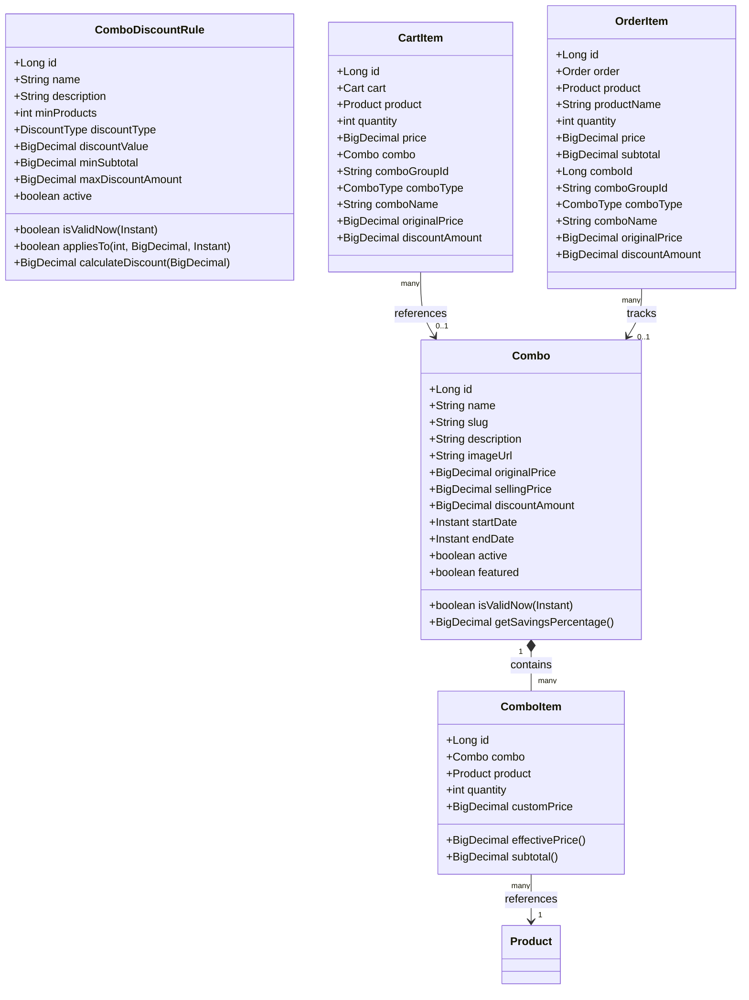
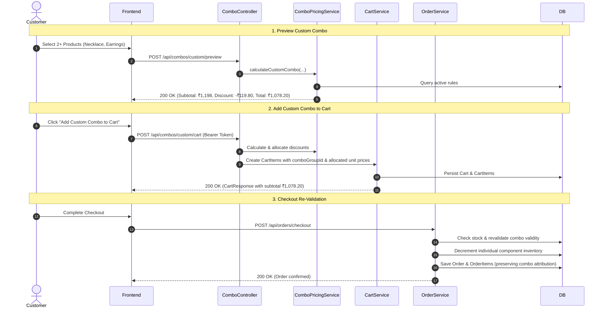

# MALKAZ Jewellery E-Commerce — Combos & Offers Feature

## 1. Executive Summary & Screenshot Alignment

The **Combos & Offers** feature delivers complete backend support for curated jewellery packages and customer-customized bundle promotions within the MALKAZ Jewellery E-Commerce platform. Based on the UI design specification, the feature consists of two main experiences:

1. **Predefined Jewellery Combos:**
   Administrator-curated jewellery sets presented in promotional cards with dynamic savings calculations:
   - **Royal Elegance**: Necklace + Earrings — Selling Price ₹1,499 (Original ₹1,999, Save ₹500).
   - **Festive Glow**: Bangles + Earrings + Necklace — Selling Price ₹2,199 (Original ₹2,899, Save ₹700).
   - **Everyday Charm**: Bracelet + Ring + Earrings — Selling Price ₹899 (Original ₹1,199, Save ₹300).
2. **Build Your Own Combo (Custom Combo):**
   Interactive 3-step shopping flow:
   - **Step 1: Select Products**: Choose from individual jewellery products (Necklace ₹799, Earrings ₹399, Bracelet ₹499, Ring ₹299, Bangles ₹599, Pendant ₹349, etc.).
   - **Step 2: Get Discount**: Real-time server-side discount evaluation based on active configurable business rules (default: selecting 2 or more products unlocks a 10% combo discount).
   - **Step 3: Add to Cart**: Atomically add custom bundles to the cart with distinct group tracking and allocated discounted unit prices.

---

## 2. Architecture & Domain Model



---

## 3. Database Schema & Flyway Migration

Database changes are managed via Flyway migration script `V3__create_combos_and_offers_tables.sql`.

### 3.1 `combos` Table
| Column | Type | Constraints / Defaults | Description |
|---|---|---|---|
| `id` | `BIGINT` | PRIMARY KEY, AUTO_INCREMENT | Unique identifier |
| `name` | `VARCHAR(180)` | NOT NULL, UNIQUE | Display name (e.g., "Royal Elegance") |
| `slug` | `VARCHAR(220)` | NOT NULL, UNIQUE | SEO URL slug |
| `description` | `VARCHAR(2000)` | NULL | Detailed set description |
| `image_url` | `VARCHAR(1000)` | NULL | Promotional banner / image URL |
| `original_price` | `DECIMAL(12,2)`| NOT NULL, DEFAULT 0.00 | Total standard component price |
| `selling_price` | `DECIMAL(12,2)` | NOT NULL, DEFAULT 0.00 | Bundle promotional price |
| `discount_amount` | `DECIMAL(12,2)`| NOT NULL, DEFAULT 0.00 | Total customer savings |
| `start_date` | `DATETIME` | NULL | Activation start timestamp |
| `end_date` | `DATETIME` | NULL | Activation expiration timestamp |
| `active` | `BOOLEAN` | NOT NULL, DEFAULT TRUE | Status toggle |
| `featured` | `BOOLEAN` | NOT NULL, DEFAULT FALSE| Flag for homepage highlights |
| `created_at` | `TIMESTAMP` | NOT NULL, CURRENT_TIMESTAMP | Record creation time |
| `updated_at` | `TIMESTAMP` | NOT NULL, ON UPDATE CURRENT_TIMESTAMP | Record modification time |

### 3.2 `combo_items` Table
| Column | Type | Constraints | Description |
|---|---|---|---|
| `id` | `BIGINT` | PRIMARY KEY, AUTO_INCREMENT | Unique identifier |
| `combo_id` | `BIGINT` | NOT NULL, FK -> combos(id) | Parent combo |
| `product_id` | `BIGINT` | NOT NULL, FK -> products(id) | Associated product |
| `quantity` | `INT` | NOT NULL, DEFAULT 1 | Item quantity in bundle |
| `custom_price` | `DECIMAL(12,2)` | NULL | Optional price override |

### 3.3 `combo_discount_rules` Table
| Column | Type | Constraints | Description |
|---|---|---|---|
| `id` | `BIGINT` | PRIMARY KEY, AUTO_INCREMENT | Unique identifier |
| `name` | `VARCHAR(150)` | NOT NULL | Rule display name |
| `description` | `VARCHAR(500)` | NULL | Promotion summary |
| `min_products` | `INT` | NOT NULL, DEFAULT 2 | Minimum distinct products required |
| `discount_type` | `VARCHAR(32)` | NOT NULL | `PERCENTAGE` or `FIXED` |
| `discount_value` | `DECIMAL(12,2)`| NOT NULL | Percentage rate or flat amount |
| `min_subtotal` | `DECIMAL(12,2)`| NULL | Optional minimum spend threshold |
| `max_discount_amount`| `DECIMAL(12,2)`| NULL | Maximum discount cap |
| `start_date` | `DATETIME` | NULL | Campaign validity start |
| `end_date` | `DATETIME` | NULL | Campaign validity end |
| `active` | `BOOLEAN` | NOT NULL, DEFAULT TRUE | Rule active status |

### 3.4 Cart & Order Item Alterations
`cart_items` and `order_items` were enhanced with combo attribution columns:
- `combo_id BIGINT NULL`: Predefined combo ID.
- `combo_group_id VARCHAR(64) NULL`: UUID grouping distinct items that belong to the same combo instance.
- `combo_type VARCHAR(32) NULL`: `PREDEFINED` or `CUSTOM`.
- `combo_name VARCHAR(180) NULL`: Display name of the combo.
- `original_price DECIMAL(12,2) NULL`: Base undiscounted product unit price.
- `discount_amount DECIMAL(12,2) NULL`: Allocated discount on this component.

---

## 4. Pricing & Mathematical Formulation

### 4.1 Server-Authoritative Price Calculation
**Crucial Security Boundary**: Clients never submit prices or discounts. All pricing is recalculated from source entity values in the database using high-precision `BigDecimal`.

### 4.2 Proportional Discount Allocation Algorithm
When a bundle is added to the cart, the total discount must be distributed among component items while strictly preserving the bundle price:
$$\text{component\_subtotal}_i = \text{base\_price}_i \times \text{quantity}_i$$
$$\text{original\_subtotal} = \sum_{i=1}^n \text{component\_subtotal}_i$$
$$\text{item\_discount}_i = \text{round}\left( \text{total\_discount} \times \frac{\text{component\_subtotal}_i}{\text{original\_subtotal}}, 2 \right)$$

#### Penny Conservation Guarantee:
Due to floating-point rounding when dividing cents across items, rounding differences can emerge. MALKAZ backend enforces exact penny conservation:
$$\text{item\_discount}_n = \text{total\_discount} - \sum_{i=1}^{n-1} \text{item\_discount}_i$$
$$\text{discounted\_unit\_price}_i = \frac{\text{component\_subtotal}_i - \text{item\_discount}_i}{\text{quantity}_i}$$

This guarantees:
$$\sum_{i=1}^n (\text{discounted\_unit\_price}_i \times \text{quantity}_i) \equiv \text{selling\_price}$$
down to ₹0.01 with zero precision drift.

---

## 5. Cart & Order Integration Flow



---

## 6. Complete API Reference

### 6.1 Public APIs

#### `GET /api/combos`
Returns paginated list of active, valid predefined combos.
- **Parameters**: `page` (default 0), `size` (default 12), `sort`
- **Response**:
```json
{
  "success": true,
  "message": "Combos fetched successfully.",
  "data": {
    "content": [
      {
        "id": 1,
        "name": "Royal Elegance",
        "slug": "royal-elegance",
        "description": "Necklace + Earrings set for regal elegance.",
        "imageUrl": "https://malkaz.com/images/royal-elegance.jpg",
        "originalPrice": 1999.00,
        "sellingPrice": 1499.00,
        "savingsAmount": 500.00,
        "savingsPercentage": 25.0,
        "inStock": true,
        "active": true,
        "featured": true,
        "items": [
          {
            "id": 1,
            "productId": 10,
            "productName": "Emerald Choker Necklace",
            "quantity": 1,
            "basePrice": 1200.00,
            "effectivePrice": 1200.00,
            "subtotal": 1200.00,
            "availableStock": 15,
            "inStock": true
          },
          {
            "id": 2,
            "productId": 11,
            "productName": "Emerald Drop Earrings",
            "quantity": 1,
            "basePrice": 799.00,
            "effectivePrice": 799.00,
            "subtotal": 799.00,
            "availableStock": 20,
            "inStock": true
          }
        ]
      }
    ],
    "pageNumber": 0,
    "pageSize": 12,
    "totalElements": 1,
    "totalPages": 1
  }
}
```

#### `GET /api/combos/featured`
Returns all active predefined combos marked `featured: true`.

#### `GET /api/combos/{slug}`
Fetches combo details and product components by SEO slug.

#### `GET /api/combos/custom/products`
Returns paginated active products eligible for "Build Your Own Combo".

#### `POST /api/combos/custom/preview`
Simulates combo discount without cart modification.
- **Request**:
```json
{
  "items": [
    { "productId": 10, "quantity": 1 },
    { "productId": 11, "quantity": 1 }
  ]
}
```
- **Response**:
```json
{
  "success": true,
  "message": "Custom combo preview calculated successfully.",
  "data": {
    "items": [
      {
        "productId": 10,
        "productName": "Emerald Choker Necklace",
        "imageUrl": null,
        "quantity": 1,
        "unitPrice": 1200.00,
        "subtotal": 1200.00,
        "discountedUnitPrice": 1079.94,
        "allocatedDiscount": 120.06,
        "inStock": true,
        "availableStock": 15
      },
      {
        "productId": 11,
        "productName": "Emerald Drop Earrings",
        "imageUrl": null,
        "quantity": 1,
        "unitPrice": 799.00,
        "subtotal": 799.00,
        "discountedUnitPrice": 719.16,
        "allocatedDiscount": 79.84,
        "inStock": true,
        "availableStock": 20
      }
    ],
    "totalItemCount": 2,
    "distinctProductCount": 2,
    "originalSubtotal": 1999.00,
    "discountAmount": 199.90,
    "finalTotal": 1799.10,
    "discountPercentage": 10.0,
    "appliedRuleName": "Combo Discount (10%)",
    "eligible": true,
    "eligibleMessage": "Eligible for 10% Combo Discount!"
  }
}
```

---

### 6.2 Customer Cart APIs (Authenticated)

#### `POST /api/combos/{id}/cart`
Adds a predefined combo to the customer's cart.
- **Headers**: `Authorization: Bearer <token>`
- **Request Body (Optional)**:
```json
{
  "quantity": 1
}
```

#### `POST /api/combos/custom/cart`
Adds a custom-built combo to the customer's cart.
- **Headers**: `Authorization: Bearer <token>`
- **Request Body**:
```json
{
  "items": [
    { "productId": 10, "quantity": 1 },
    { "productId": 11, "quantity": 1 }
  ]
}
```

#### `DELETE /api/combos/cart/groups/{comboGroupId}`
Atomically removes all items belonging to a specific combo instance in the user's cart.
- **Headers**: `Authorization: Bearer <token>`

---

### 6.3 Admin APIs (`hasAnyRole('ADMIN', 'STAFF')`)

#### `GET /api/admin/combos`
Lists all combos with optional search query parameter (`?query=festive`).

#### `POST /api/admin/combos`
Creates a new predefined combo bundle.
```bash
curl -X POST http://localhost:8080/api/admin/combos \
  -H "Authorization: Bearer <admin-token>" \
  -H "Content-Type: application/json" \
  -d '{
    "name": "Festive Glow",
    "slug": "festive-glow",
    "description": "Bangles + Earrings + Necklace celebratory set.",
    "sellingPrice": 2199.00,
    "originalPrice": 2899.00,
    "active": true,
    "featured": true,
    "items": [
      { "productId": 10, "quantity": 1 },
      { "productId": 11, "quantity": 1 },
      { "productId": 12, "quantity": 1 }
    ]
  }'
```

#### `PUT /api/admin/combos/{id}`
Updates an existing combo and recalculates component pricing.

#### `PATCH /api/admin/combos/{id}/status`
Toggles active status (`{"active": false}`).

#### `DELETE /api/admin/combos/{id}`
Deletes a combo.

#### `GET /api/admin/combos/rules`
Lists all custom combo discount rules.

#### `POST /api/admin/combos/rules`
Creates a discount rule.
```json
{
  "name": "Festive 15% Off 3+ Items",
  "description": "Buy 3 jewellery items and save 15%",
  "minProducts": 3,
  "discountType": "PERCENTAGE",
  "discountValue": 15.00,
  "minSubtotal": 1000.00,
  "maxDiscountAmount": 500.00,
  "active": true
}
```

#### `PUT /api/admin/combos/rules/{id}`
Updates an existing discount rule.

#### `DELETE /api/admin/combos/rules/{id}`
Deletes a discount rule.

---

## 7. Verification & Test Suite

The feature includes comprehensive unit and integration test coverage:

- **`ComboPricingServiceTest`**: Validates proportional discount distribution, half-up rounding, minimum distinct product thresholds, discount caps, and penny conservation.
- **`ComboIntegrationTest`**: Full MockMvc integration tests verifying public catalog routes, unauthenticated protection (401), customer forbidden routes (403), authenticated cart modifications, combo group deletions, and admin CRUD operations.

To execute the entire test suite:
```powershell
$env:JAVA_HOME="C:\Users\HP\.jdks\ms-21.0.9"
$env:Path = "$env:JAVA_HOME\bin;$env:Path"
cd artifacts/api-server/spring-app
mvn test
```
**Test Results**: **92 tests run, 0 failures, 0 errors**.

