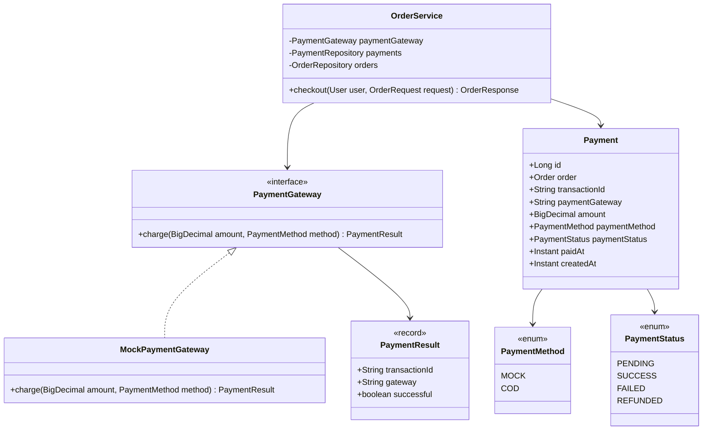
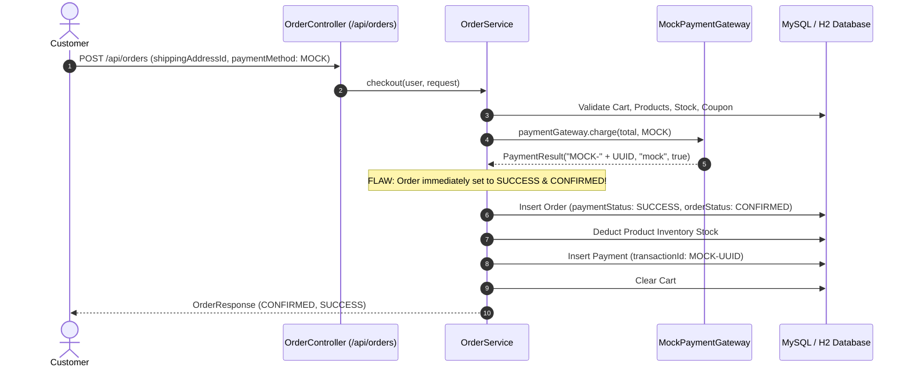
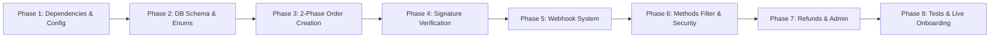

# Razorpay Integration & Payment Functionality Backend Audit — MALKAZ

**Project:** MALKAZ Luxury Fine Jewellery E-Commerce (`cosmetics-ecommerce-backend`)  
**Architecture:** Java 21, Spring Boot 3.4.3, Spring Data JPA, Spring Security (Stateless JWT), MySQL / H2  
**Audit Date:** November 5, 2026  
**Auditor:** Senior Java Spring Boot Developer, Payment Gateway Integration Expert & Application Security Auditor  
**Audit Scope:** Read-Only Technical Architecture, Codebase, Database Schema, and Security Audit  

---

## 1. Executive Summary

A comprehensive, read-only technical audit of the MALKAZ Jewellery backend was conducted to evaluate the status, security, and production readiness of the **Razorpay payment gateway integration** and all payment-related functionalities.

### Key Finding:
> [!CAUTION]
> **Razorpay is completely NOT IMPLEMENTED in the backend codebase.**  
> The current application relies entirely on an in-memory **`MockPaymentGateway`** that generates fake UUID transaction tokens (`"MOCK-" + UUID`) and automatically approves every checkout without contacting any real payment gateway.

### High-Level Summary of Findings:
1. **Zero Razorpay SDK or Integration**: `pom.xml` does not include `com.razorpay:razorpay-java`. No Razorpay client, order creation, payment ID capture, or signature verification exists.
2. **Missing Payment Methods**: The `PaymentMethod` enum only supports `MOCK` and `COD`. The required trio (**UPI**, **UPI QR**, **Net Banking**) is completely absent in both enums and processing logic.
3. **Critical Order Security Bypass**: Any authenticated customer can submit `POST /api/orders` with `paymentMethod: MOCK`, and the backend immediately marks the order as **`PAID`** (`PaymentStatus.SUCCESS`) and **`CONFIRMED`**, deducts real database stock, and sends order confirmation emails without receiving any payment.
4. **No Webhook Infrastructure**: No webhook endpoints, HMAC SHA-256 signature validators, or event handlers exist to capture asynchronous payment confirmations, failures, or refunds.
5. **Database Deficiencies**: The `payments` table contains no fields for `razorpay_order_id`, `razorpay_payment_id`, `razorpay_signature`, `currency`, `failure_reason`, `refund_id`, or `webhook_event_id`.
6. **Hardcoded Credential Exposure**: An active Google Mail App Password was discovered hardcoded as the default fallback in `src/main/resources/application.yml` (line 63).

### Final Verdict:
**`NOT IMPLEMENTED`** (Existing codebase contains only a dummy prototype/mock stub). The backend is **NOT production-ready** and cannot process live customer payments.

---

## 2. Existing Payment Architecture

The existing payment architecture in the backend is structured as follows:



### Component Inventory & Code References

| Component | Path | Status | Finding |
|---|---|---|---|
| **SDK Dependency** | `pom.xml` | **MISSING** | No Razorpay dependency defined. |
| **Configuration** | `src/main/resources/application.yml` | **MISSING** | No Razorpay key, secret, or webhook configuration. |
| **Gateway Interface** | `com.cosmetics.ecommerce.payment.PaymentGateway` | **BASIC STUB** | Single method `charge(BigDecimal, PaymentMethod)`. Incompatible with two-phase gateway flows. |
| **Gateway Implementation** | `com.cosmetics.ecommerce.payment.MockPaymentGateway` | **PROTOTYPE ONLY** | Hardcoded to return `"MOCK-" + UUID.randomUUID()` with `successful: true`. |
| **Payment Entity** | `com.cosmetics.ecommerce.entity.Payment` | **INSUFFICIENT** | Lacks all Razorpay tracking fields. |
| **Payment Repository** | `com.cosmetics.ecommerce.repository.PaymentRepository` | **EMPTY** | Bare `JpaRepository<Payment, Long>` with zero custom queries. |
| **Payment Enums** | `com.cosmetics.ecommerce.enums.PaymentMethod` | **NON-COMPLIANT** | Contains only `MOCK` and `COD`. Missing `UPI`, `UPI_QR`, `NET_BANKING`. |
| **Payment Statuses** | `com.cosmetics.ecommerce.enums.PaymentStatus` | **PARTIAL** | Defines `PENDING`, `SUCCESS`, `FAILED`, `REFUNDED`. |
| **Checkout Service** | `com.cosmetics.ecommerce.service.OrderService` | **VULNERABLE** | Marks orders `SUCCESS` synchronously via mock. |
| **Order Controller** | `com.cosmetics.ecommerce.controller.OrderController` | **BASIC** | Exposes `POST /orders`, but zero payment/verification endpoints. |
| **Payment Controller** | *None* | **MISSING** | No `PaymentController` or `RazorpayController` exists. |
| **Webhook Controller** | *None* | **MISSING** | No webhook endpoints exist. |

---

## 3. Razorpay Integration Audit (16-Point Inspection)

| # | Razorpay Functionality | Status | File Reference | Technical Finding |
|---|---|---|---|---|
| **1** | **Razorpay Client Initialization** | **NOT IMPLEMENTED** | `com.cosmetics.ecommerce.payment` | No `RazorpayClient` bean or instantiation exists in the application. |
| **2** | **API Key ID Configuration** | **NOT IMPLEMENTED** | `application.yml` | No configuration property or environment variable mapping for `RAZORPAY_KEY_ID`. |
| **3** | **API Key Secret Configuration** | **NOT IMPLEMENTED** | `application.yml` | No configuration property or environment variable mapping for `RAZORPAY_KEY_SECRET`. |
| **4** | **Razorpay Order Creation API** | **NOT IMPLEMENTED** | `OrderService.java` | Backend does not invoke `client.orders.create(...)`. No Razorpay order is initialized before checkout. |
| **5** | **Razorpay Payment ID Handling** | **NOT IMPLEMENTED** | `Payment.java` | Neither `Payment` nor `Order` entities store `razorpay_payment_id` (`pay_...`). |
| **6** | **Razorpay Order ID Handling** | **NOT IMPLEMENTED** | `Order.java`, `Payment.java` | Neither `Payment` nor `Order` entities store `razorpay_order_id` (`order_...`). |
| **7** | **Razorpay Signature Verification** | **NOT IMPLEMENTED** | *Missing class* | No HMAC SHA-256 signature calculation exists (`Utils.verifyPaymentSignature` is absent). |
| **8** | **Payment Capture Handling** | **NOT IMPLEMENTED** | *Missing class* | No automatic or manual payment capture (`client.payments.capture(...)`) is implemented. |
| **9** | **Payment Failure Handling** | **NOT IMPLEMENTED** | `OrderService.java:119` | On payment failure, an exception is thrown, rolling back the transaction. No record of the failed attempt or failure reason is saved. |
| **10** | **Payment Refund Functionality** | **NOT IMPLEMENTED** | `OrderService.java:199` | Order cancellation (`orders.cancel()`) restores inventory but **never** initiates a refund via Razorpay (`client.payments.refund(...)`). |
| **11** | **Payment Status Verification** | **NOT IMPLEMENTED** | *Missing class* | No service or API exists to fetch payment status from Razorpay (`client.payments.fetch(...)`). |
| **12** | **Razorpay Webhook Integration** | **NOT IMPLEMENTED** | *Missing controller* | No webhook endpoint is mapped (e.g. `POST /api/payments/webhook`). |
| **13** | **Webhook Signature Verification** | **NOT IMPLEMENTED** | *Missing class* | No verification of the `X-Razorpay-Signature` header using `RAZORPAY_WEBHOOK_SECRET`. |
| **14** | **Webhook Event Processing** | **NOT IMPLEMENTED** | *Missing class* | No event listeners or handlers for `payment.captured`, `payment.failed`, `order.paid`, or `refund.processed`. |
| **15** | **Duplicate Webhook Prevention** | **NOT IMPLEMENTED** | *Missing class* | No tracking of `x-razorpay-event-id` or idempotency store to prevent replay attacks or double-processing. |
| **16** | **Payment Transaction Persistence** | **PARTIALLY IMPLEMENTED** | `Payment.java` | Basic entity exists, but stores only mock UUIDs (`MOCK-f79a...`), mock gateway names (`"mock"`), and no Razorpay audit metadata. |

---

## 4. Supported Payment Methods Audit

The MALKAZ store requirement stipulates supporting **ONLY** three payment methods:
1. **UPI** (Direct collect / intent)
2. **UPI QR** (Dynamic QR display and tracking)
3. **Net Banking** (Bank selection and redirection)
4. **Cards must NOT be supported**.

### Audit Findings:

```java
// File: src/main/java/com/cosmetics/ecommerce/enums/PaymentMethod.java
package com.cosmetics.ecommerce.enums;

public enum PaymentMethod {
    MOCK,
    COD
}
```

1. **UPI, UPI QR, Net Banking Missing**:
   - `PaymentMethod.UPI`: **Missing**.
   - `PaymentMethod.UPI_QR`: **Missing**.
   - `PaymentMethod.NET_BANKING`: **Missing**.
   - If a frontend or API client submits `UPI`, `UPI_QR`, or `NET_BANKING` in `POST /api/orders`, Jackson fails with `400 Bad Request` (`HttpMessageNotReadableException`) because these values do not exist in the enum.
2. **Cards Exclusion**:
   - Cards are not explicitly in `PaymentMethod`, but there is **no guardrail** in place to reject card-based payment requests if Razorpay's default checkout opens. In Razorpay Standard Checkout, cards are enabled by default unless explicitly disabled via the `method` options configuration or backend order filter.
3. **COD Flaw**:
   - If a customer places an order with `paymentMethod: COD`, `OrderService.checkout()` executes:
     ```java
     PaymentGateway.PaymentResult result = paymentGateway.charge(total, request.paymentMethod());
     order.setPaymentStatus(PaymentStatus.SUCCESS);
     ```
   - Cash on Delivery orders are immediately marked as **`PAID`** (`PaymentStatus.SUCCESS`) at checkout time rather than remaining in `PaymentStatus.PENDING` until cash collection upon delivery.

---

## 5. Checkout & Order Lifecycle Analysis

### Current Implementation Flow (`OrderService.java:52-176`):


### Critical Flaws in Current Flow:
1. **Single-Phase Synchronous Execution**:
   - Real payment gateways are asynchronous two-phase systems. The current backend expects a payment gateway to return `true`/`false` immediately inside a single HTTP request.
2. **Orders Marked Paid Without Receipt of Funds**:
   - Any client calling `POST /api/orders` with `paymentMethod: "MOCK"` receives a valid, confirmed order and email without any payment gateway contact.
3. **Inventory Depletion on Failed Attempts**:
   - In `OrderService.checkout()`, if a payment fails in `paymentGateway.charge()`, the transaction rolls back, which is good. However, no record of the attempt, customer intent, or failure reason is retained, preventing sales recovery.
4. **Order Cancellation Does Not Refund**:
   - `OrderService.cancel()` sets `orderStatus = CANCELLED` and restores stock, but **never** initiates a refund. In an online payment setup, customer cancellations must trigger a Razorpay refund (`client.payments.refund(...)`) and set `paymentStatus = REFUNDED`.
5. **No Stock Concurrency Locks**:
   - In `OrderService.java:69-71`, stock check is performed without database pessimistic locking (`SELECT ... FOR UPDATE`). If two customers attempt to purchase the last available jewellery item concurrently, a race condition allows both checkouts to pass the validation step.

---

## 6. Database & Transaction Audit

### 6.1 Database Schema Comparison (`payments` table)

| Required Field for Razorpay | Present in Entity? | Present in Database? | Risk Level |
|---|---|---|---|
| `id` | **Yes** (`Payment.java:12`) | **Yes** | Low |
| `order_id` | **Yes** (`Payment.java:13`) | **Yes** | Low |
| `transaction_id` | **Yes** (`Payment.java:14`) | **Yes** | Low |
| `payment_gateway` | **Yes** (`Payment.java:15`) | **Yes** | Low |
| `amount` | **Yes** (`Payment.java:16`) | **Yes** | Low |
| `payment_method` | **Yes** (`Payment.java:17`) | **Yes** (Enum string) | Medium (Values limited) |
| `payment_status` | **Yes** (`Payment.java:18`) | **Yes** (Enum string) | Low |
| `razorpay_order_id` | **NO** | **NO** | **CRITICAL** |
| `razorpay_payment_id` | **NO** | **NO** | **CRITICAL** |
| `razorpay_signature` | **NO** | **NO** | **CRITICAL** |
| `currency` | **NO** | **NO** | Medium |
| `failure_code` | **NO** | **NO** | High |
| `failure_reason` | **NO** | **NO** | High |
| `refund_id` | **NO** | **NO** | High |
| `refund_status` | **NO** | **NO** | High |
| `webhook_event_id` | **NO** | **NO** | High |
| `updated_at` | **NO** | **NO** | Low |

### 6.2 Transactional & Concurrency Deficiencies:
- **`PaymentRepository` lacks lookup methods**: Only inherits `JpaRepository<Payment, Long>`. It has no methods like `findByRazorpayOrderId(...)`, `findByRazorpayPaymentId(...)`, or `findByTransactionId(...)`.
- **No Idempotency Key**: If a network timeout occurs and the customer resubmits the checkout form, the backend will process a second charge and create a duplicate order.
- **`Order` and `Payment` decoupling**: `Order` entity does not have a reference to its `Payment` or to `razorpayOrderId`. Finding the payment associated with an order requires querying the `payments` table manually.

---

## 7. Security Audit Findings

### Vulnerability 1: Critical — Mock Payment Gateway Active in Production Configuration
- **Severity**: **CRITICAL** (CVSS: 9.8)
- **File**: [`MockPaymentGateway.java`](file:///c:/Users/HP/OneDrive/Desktop/MALKAZ/cosmeticszainab/Cosmetics-E-Commerce-Backend/artifacts/api-server/spring-app/src/main/java/com/cosmetics/ecommerce/payment/MockPaymentGateway.java#L8-L14)
- **Details**: `MockPaymentGateway` is annotated with `@Component` without any `@Profile("test")` or conditional annotation. It is active in production mode. Any customer can purchase thousands of dollars of jewellery for free by sending `paymentMethod: MOCK`.

### Vulnerability 2: High — Hardcoded Email Credentials in Version Control
- **Severity**: **HIGH** (CWE-798: Use of Hard-coded Credentials)
- **File**: [`application.yml`](file:///c:/Users/HP/OneDrive/Desktop/MALKAZ/cosmeticszainab/Cosmetics-E-Commerce-Backend/artifacts/api-server/spring-app/src/main/resources/application.yml#L62-L63)
- **Code**:
  ```yaml
  username: ${MAIL_USERNAME:ahmedmudassir9594@gmail.com}
  password: ${MAIL_PASSWORD:vcyp qtwk swep mxqj}
  ```
- **Details**: An active Google App Password (`vcyp qtwk swep mxqj`) is exposed in version control as the fallback value.

### Vulnerability 3: Critical — Missing Cryptographic Signature Verification
- **Severity**: **CRITICAL** (CWE-347: Improper Verification of Cryptographic Signature)
- **Details**: The backend contains no signature verification logic. When integrating Razorpay, failure to verify HMAC SHA-256 signatures (`razorpay_order_id + "|" + razorpay_payment_id` with `key_secret`) enables malicious actors to fabricate payment confirmations and mark orders as paid.

### Vulnerability 4: High — Webhook Security Non-Existent
- **Severity**: **HIGH** (CWE-306: Missing Authentication for Critical Function)
- **Details**: There is no webhook endpoint. If an unauthenticated webhook endpoint were introduced without verifying `X-Razorpay-Signature` against `RAZORPAY_WEBHOOK_SECRET`, anyone could send forged `payment.captured` JSON payloads.

---

## 8. API Endpoint Documentation

### 8.1 Existing Order & Payment Endpoints

| HTTP Method | API URL | Controller Class | Request DTO | Response DTO | Auth Required | Implementation Status |
|---|---|---|---|---|---|---|
| `POST` | `/api/orders` | `OrderController` | `OrderRequest` | `ApiResponse<OrderResponse>` | Yes (JWT) | **MOCK ONLY** |
| `GET` | `/api/orders` | `OrderController` | *None* | `ApiResponse<PageResponse<OrderResponse>>` | Yes (JWT) | Functioning |
| `GET` | `/api/orders/{id}` | `OrderController` | *None* | `ApiResponse<OrderResponse>` | Yes (JWT) | Functioning |
| `GET` | `/api/orders/number/{orderNumber}` | `OrderController` | *None* | `ApiResponse<OrderResponse>` | Yes (JWT) | Functioning |
| `POST` | `/api/orders/{id}/cancel` | `OrderController` | *None* | `ApiResponse<OrderResponse>` | Yes (JWT) | Functioning (No Refund) |
| `GET` | `/api/admin/orders` | `AdminController` | *None* | `ApiResponse<PageResponse<OrderResponse>>` | Yes (`ADMIN`/`STAFF`) | Functioning |
| `PATCH` | `/api/admin/orders/{id}/status` | `AdminController` | `@RequestParam OrderStatus` | `ApiResponse<OrderResponse>` | Yes (`ADMIN`/`STAFF`) | Functioning |

### 8.2 Missing Endpoints Required for Razorpay Integration

| HTTP Method | API URL | Controller Class | Purpose | Auth Required |
|---|---|---|---|---|
| `POST` | `/api/payments/razorpay/create-order` | `PaymentController` | Create Razorpay Order (`order_...`) and return details to frontend | Authenticated |
| `POST` | `/api/payments/razorpay/verify` | `PaymentController` | Verify HMAC SHA-256 signature and confirm order payment | Authenticated |
| `POST` | `/api/payments/razorpay/webhook` | `RazorpayWebhookController` | Process asynchronous gateway events (`payment.captured`, `payment.failed`) | Public (HMAC Verified) |
| `GET` | `/api/payments/{orderId}` | `PaymentController` | Retrieve payment status and transaction details | Authenticated |
| `POST` | `/api/admin/payments/{id}/refund` | `AdminPaymentController` | Issue full or partial refund via Razorpay Refund API | `ADMIN` Role |

---

## 9. Build & Test Results

### Automated Build Verification:
- Command executed: `mvn test`
- Build status: **BUILD SUCCESS**
- Total tests run: **133**
- Failures: **0**, Errors: **0**, Skipped: **0**
- Execution time: ~60 seconds

### Test Coverage Analysis for Payments:
- **`OrderServiceLifecycleTest.java`**:
  - Tests `orderService.checkout()` with Mockito-mocked `PaymentGateway` returning `PaymentResult("TXN-123", "MOCK", true)`.
  - Tests stock preservation when mock gateway returns `false`.
  - Tests stock restoration on customer cancellation.
- **`AuditLoggingServiceIntegrationTest.java`**:
  - Tests audit log creation on `PAYMENT_SUCCESS`.
- **Razorpay Test Coverage**: **0%**. No tests exist for Razorpay order generation, signature verification, webhook processing, payment errors, or refund handling.

---

## 10. Summary Table & Feature Classification

| Feature | Status | Risk Level | Relevant File Reference |
|---|---|---|---|
| **Razorpay SDK** | **NOT IMPLEMENTED** | **CRITICAL** | `pom.xml` |
| **Razorpay Order Creation** | **NOT IMPLEMENTED** | **CRITICAL** | `OrderService.java` |
| **Payment Verification** | **NOT IMPLEMENTED** | **CRITICAL** | *Missing* |
| **Signature Verification** | **NOT IMPLEMENTED** | **CRITICAL** | *Missing* |
| **UPI Payment Method** | **NOT IMPLEMENTED** | **HIGH** | `PaymentMethod.java` |
| **UPI QR Payment Method** | **NOT IMPLEMENTED** | **HIGH** | `PaymentMethod.java` |
| **Net Banking Method** | **NOT IMPLEMENTED** | **HIGH** | `PaymentMethod.java` |
| **Cards Exclusion** | **NOT IMPLEMENTED** | **MEDIUM** | `PaymentMethod.java` |
| **Webhooks** | **NOT IMPLEMENTED** | **HIGH** | *Missing* |
| **Refunds** | **NOT IMPLEMENTED** | **HIGH** | `OrderService.java:199` |
| **Transaction Persistence** | **PARTIALLY IMPLEMENTED** | **HIGH** | `Payment.java`, `PaymentRepository.java` |
| **Payment Security** | **SECURITY RISK** | **CRITICAL** | `MockPaymentGateway.java`, `application.yml` |
| **Production Configuration** | **NOT IMPLEMENTED** | **CRITICAL** | `application.yml` |

---

## 11. Recommended Implementation Roadmap

To achieve a **Production-Ready Razorpay Integration** strictly supporting **UPI, UPI QR, and Net Banking (Cards Excluded)**, the following phased implementation roadmap is recommended:



### Phase 1: SDK & Configuration
1. Add `com.razorpay:razorpay-java:1.4.8` to `pom.xml`.
2. Configure environment properties in `application.yml`:
   ```yaml
   app:
     razorpay:
       key-id: ${RAZORPAY_KEY_ID:}
       key-secret: ${RAZORPAY_KEY_SECRET:}
       webhook-secret: ${RAZORPAY_WEBHOOK_SECRET:}
       currency: ${RAZORPAY_CURRENCY:INR}
   ```
3. Create `RazorpayConfig.java` to instantiate `RazorpayClient` as a Spring Bean only when `key-id` and `key-secret` are present.

### Phase 2: Schema Migration (`V6__razorpay_payment_schema.sql`)
1. Update `PaymentMethod.java` enum to:
   ```java
   public enum PaymentMethod {
       UPI,
       UPI_QR,
       NET_BANKING,
       COD
   }
   ```
2. Add columns to `payments` table via Flyway `V6`:
   - `razorpay_order_id VARCHAR(100)` (indexed)
   - `razorpay_payment_id VARCHAR(100)` (indexed, unique)
   - `razorpay_signature VARCHAR(255)`
   - `currency VARCHAR(10) DEFAULT 'INR'`
   - `failure_code VARCHAR(100)`
   - `failure_reason VARCHAR(500)`
   - `refund_id VARCHAR(100)`
   - `refund_status VARCHAR(50)`
   - `webhook_event_id VARCHAR(100)` (unique index)
   - `updated_at TIMESTAMP`
3. Add `razorpay_order_id` to `orders` table.

### Phase 3: Two-Phase Checkout Flow
1. Replace the single-phase synchronous checkout with a two-phase checkout:
   - **Step 1: Order Initiation (`POST /api/payments/razorpay/create-order`)**:
     - Validates cart and reserves stock.
     - Creates order in database with `orderStatus = PENDING` and `paymentStatus = PENDING`.
     - Calls Razorpay API: `client.orders.create(...)` with `amount` (in paise: `total.multiply(100)`), `currency: "INR"`, `receipt: order.getOrderNumber()`, notes.
     - Saves `razorpay_order_id` on the order and payment records.
     - Returns `{ orderId, razorpayOrderId, amount, currency, keyId }` to frontend.
   - **Step 2: Frontend Checkout Modal**:
     - Frontend opens Razorpay modal with `order_id` and configures payment options:
       ```javascript
       config: {
         display: {
           blocks: {
             banks: { name: 'Net Banking', instruments: [{ method: 'netbanking' }] },
             upi: { name: 'UPI / QR', instruments: [{ method: 'upi' }] }
           },
           sequence: ['block.upi', 'block.banks'],
           preferences: { show_default_blocks: false }
         }
       }
       ```
     - Cards are disabled in the display options.

### Phase 4: Server-Side Cryptographic Signature Verification
1. Implement `POST /api/payments/razorpay/verify`:
   - Payload: `{ orderId, razorpayOrderId, razorpayPaymentId, razorpaySignature }`.
   - Calculate HMAC SHA-256 signature using `key_secret`:
     ```java
     String payload = razorpayOrderId + "|" + razorpayPaymentId;
     boolean valid = Utils.verifyPaymentSignature(payload, razorpaySignature, razorpaySecret);
     ```
   - Verify that the payment amount matches the order total.
   - Update order to `paymentStatus = SUCCESS`, `orderStatus = CONFIRMED`.
   - Clear user's cart and send order confirmation email.

### Phase 5: Webhook Handler & Idempotency
1. Implement `POST /api/payments/razorpay/webhook`:
   - Verify `X-Razorpay-Signature` header against raw body bytes using `Utils.verifyWebhookSignature`.
   - Ensure webhook route is exempt from JWT in `SecurityConfig.java`.
   - Check `x-razorpay-event-id` for duplicate processing.
   - Handle events:
     - `order.paid` / `payment.captured`: Fallback confirmation in case customer browser closed before Step 4.
     - `payment.failed`: Update payment record to `FAILED` with `error_description`.
     - `refund.processed`: Update payment record to `REFUNDED`.

### Phase 6: Refund Management & Admin Tools
1. Implement `POST /api/admin/payments/{id}/refund`:
   - Calls `client.payments.refund(...)`.
   - Sets payment status to `REFUNDED` and order status to `CANCELLED`.
   - Restores stock inventory.

### Phase 7: Credentials Security & Automated Tests
1. Remove hardcoded Google Mail App Password from `application.yml`.
2. Secure all Razorpay secrets using environment variables (`RAZORPAY_KEY_ID`, `RAZORPAY_KEY_SECRET`, `RAZORPAY_WEBHOOK_SECRET`).
3. Add comprehensive Mockito unit tests and MockMvc integration tests with simulated Razorpay webhooks and signature verification.

---

## 12. Final Verdict

| Dimension | Assessment |
|---|---|
| **Razorpay SDK & APIs** | **NOT IMPLEMENTED** |
| **Supported Methods (UPI, QR, Net Banking)** | **NOT IMPLEMENTED** |
| **Payment Security & Verification** | **SECURITY RISK** |
| **Database Readiness** | **PARTIALLY IMPLEMENTED (Incomplete Schema)** |
| **Overall Classification** | **NOT IMPLEMENTED (Mock Prototype Only)** |

> **Conclusion**: The MALKAZ Jewellery backend is currently running on a simulation prototype. It requires the implementation of the phased roadmap above before live customer transactions can be accepted safely.

