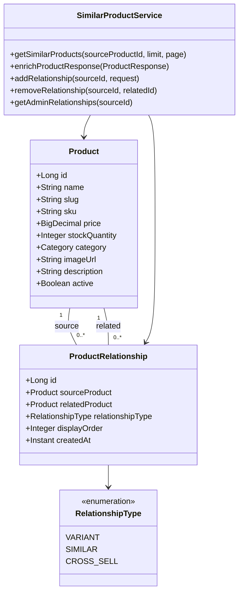
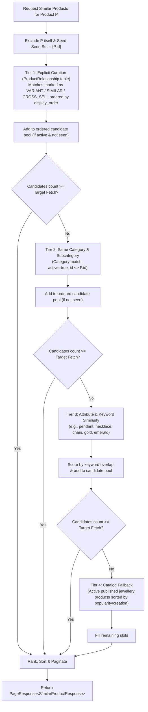

# Similar Products & Product Variants Engine — MALKAZ Backend

## 1. Executive Summary

This document describes the architectural implementation of the **Similar Products and Product Variants Engine** in the MALKAZ Fine Jewellery Spring Boot backend.

### The Problem
On the product details page (`/product/{id}` or `/product/{slug}`), the customer views the main product image (e.g. *Plated Pendant Necklace*). Previously, thumbnail strips or secondary containers underneath the primary image rendered duplicate images of the exact same product because no distinct variant/similarity resolution service existed.

### The Solution
A 4-tier similarity matching algorithm, backed by a dedicated `product_relationships` relational mapping table with full administrative curation, dynamic category/attribute matching, catalog fallbacks, and automatic enrichment of product responses. The frontend displays distinct, relevant jewellery alternatives (e.g., *Emerald Drop Pendant*, *Floral Gold Necklace*, *Classic Round Pendant*, *Golden Chain Necklace*) without requiring any frontend code changes.

---

## 2. Architecture & Domain Model



### Key Entities & Files

| Component | Path | Description |
|-----------|------|-------------|
| **Entity** | `com.cosmetics.ecommerce.entity.ProductRelationship` | JPA entity mapping manual links between products |
| **Enum** | `com.cosmetics.ecommerce.enums.RelationshipType` | `VARIANT`, `SIMILAR`, `CROSS_SELL` |
| **Enum** | `com.cosmetics.ecommerce.enums.AuditAction` | Added `PRODUCT_RELATIONSHIP_CREATE`, `PRODUCT_RELATIONSHIP_DELETE` |
| **Repository** | `com.cosmetics.ecommerce.repository.ProductRelationshipRepository` | High-performance queries with `JOIN FETCH` to eliminate N+1 |
| **Repository** | `com.cosmetics.ecommerce.repository.ProductRepository` | Added candidate fetching queries with category join fetch |
| **DTOs** | `com.cosmetics.ecommerce.dto.ProductRelationshipDtos` | `SimilarProductResponse`, `ProductRelationshipRequest`, `ProductRelationshipResponse` |
| **DTOs** | `com.cosmetics.ecommerce.dto.CatalogDtos.ProductResponse` | Enriched with `brandName`, `relationshipType`, `similarProducts` |
| **Service** | `com.cosmetics.ecommerce.service.SimilarProductService` | 4-tier candidate ranking, deduplication, pagination, and admin CRUD |
| **Controller** | `com.cosmetics.ecommerce.controller.ProductController` | Public `/api/products/{id}/similar` and Admin `/api/admin/products/...` |
| **Migration** | `db/migration/V4__create_product_relationships_table.sql` | Flyway DDL with FKs, unique index, and check constraint |

---

## 3. Database Schema (`V4__create_product_relationships_table.sql`)

```sql
CREATE TABLE IF NOT EXISTS product_relationships (
    id BIGINT AUTO_INCREMENT PRIMARY KEY,
    source_product_id BIGINT NOT NULL,
    related_product_id BIGINT NOT NULL,
    relationship_type VARCHAR(32) NOT NULL DEFAULT 'SIMILAR',
    display_order INT NOT NULL DEFAULT 0,
    created_at TIMESTAMP NOT NULL DEFAULT CURRENT_TIMESTAMP,
    CONSTRAINT fk_prod_rel_source FOREIGN KEY (source_product_id) REFERENCES products(id) ON DELETE CASCADE,
    CONSTRAINT fk_prod_rel_target FOREIGN KEY (related_product_id) REFERENCES products(id) ON DELETE CASCADE,
    CONSTRAINT uk_prod_rel_source_target UNIQUE (source_product_id, related_product_id),
    CONSTRAINT chk_prod_rel_no_self_ref CHECK (source_product_id <> related_product_id)
);

CREATE INDEX idx_prod_rel_source ON product_relationships(source_product_id, display_order, created_at);
CREATE INDEX idx_prod_rel_target ON product_relationships(related_product_id);
```

### Safety & Integrity Constraints:
1. **Self-Reference Prevention**: Enforced at the DB level (`CHECK (source_product_id <> related_product_id)`), JPA entity lifecycle (`@PrePersist` / `@PreUpdate`), and service validation level (`BadRequestException`).
2. **Duplicate Link Prevention**: Unique constraint on `(source_product_id, related_product_id)`.
3. **Cascading Cleanup**: Deleting a product automatically cascades and purges all incoming and outgoing relationship records.

---

## 4. 4-Tier Candidate Ranking & Matching Algorithm

When resolving similar items for a target product $P$ (with requested limit $L$ and page offset $O$):



### Deduplication Rules:
- The viewed product itself ($P.id$) is strictly excluded from all tiers.
- A `Set<Long> seenIds` guarantees that no product appears more than once in the output, even if it qualifies under multiple tiers.
- Only active products (`active = true`) with valid stock and images are returned to customer endpoints.

---

## 5. API Reference

### 5.1 Public Endpoints

#### A. Get Similar Products by Product ID
- **URL**: `GET /api/products/{productId}/similar`
- **Query Parameters**:
  - `limit` (optional, default `4`): Number of similar products per page.
  - `page` (optional, default `0`): Zero-indexed page number.
- **Authentication**: Public (no token required).
- **Example Response (HTTP 200)**:
```json
{
  "success": true,
  "data": {
    "content": [
      {
        "id": 2,
        "name": "Emerald Drop Pendant",
        "slug": "emerald-drop-pendant",
        "sku": "SKU-ED-1",
        "price": 15.00,
        "originalPrice": 18.00,
        "stockQuantity": 20,
        "imageUrl": "https://malkaz.com/images/emerald-drop.jpg",
        "categoryName": "Pendants & Necklaces",
        "brandName": "MALKAZ",
        "relationshipType": "VARIANT",
        "score": 1000.0,
        "matchReason": "Explicitly curated variant"
      },
      {
        "id": 3,
        "name": "Floral Gold Necklace",
        "slug": "floral-gold-necklace",
        "sku": "SKU-FG-1",
        "price": 18.00,
        "originalPrice": 22.00,
        "stockQuantity": 15,
        "imageUrl": "https://malkaz.com/images/floral-gold.jpg",
        "categoryName": "Pendants & Necklaces",
        "brandName": "MALKAZ",
        "relationshipType": "SIMILAR",
        "score": 500.0,
        "matchReason": "Same category: Pendants & Necklaces"
      },
      {
        "id": 4,
        "name": "Classic Round Pendant",
        "slug": "classic-round-pendant",
        "sku": "SKU-CR-1",
        "price": 14.00,
        "originalPrice": 16.00,
        "stockQuantity": 10,
        "imageUrl": "https://malkaz.com/images/classic-round.jpg",
        "categoryName": "Pendants & Necklaces",
        "brandName": "MALKAZ",
        "relationshipType": "SIMILAR",
        "score": 500.0,
        "matchReason": "Same category: Pendants & Necklaces"
      },
      {
        "id": 5,
        "name": "Golden Chain Necklace",
        "slug": "golden-chain-necklace",
        "sku": "SKU-GC-1",
        "price": 16.00,
        "originalPrice": 19.00,
        "stockQuantity": 12,
        "imageUrl": "https://malkaz.com/images/golden-chain.jpg",
        "categoryName": "Pendants & Necklaces",
        "brandName": "MALKAZ",
        "relationshipType": "SIMILAR",
        "score": 250.0,
        "matchReason": "Style & design attribute match"
      }
    ],
    "page": 0,
    "size": 4,
    "totalElements": 4,
    "totalPages": 1,
    "first": true,
    "last": true
  },
  "message": "Similar products retrieved successfully"
}
```

#### B. Get Similar Products by Slug
- **URL**: `GET /api/products/slug/{slug}/similar`
- **Query Parameters**: `limit`, `page`
- **Authentication**: Public.

#### C. Enriched Product Details
- **URL**: `GET /api/products/{id}` or `GET /api/products/slug/{slug}`
- The standard `ProductResponse` automatically includes the populated `similarProducts` list alongside existing product fields:
```json
{
  "success": true,
  "data": {
    "id": 1,
    "name": "Plated Pendant Necklace",
    "slug": "plated-pendant-necklace",
    "price": 12.00,
    "imageUrl": "https://malkaz.com/images/plated-pendant.jpg",
    "brandName": "MALKAZ",
    "similarProducts": [
      {
        "id": 2,
        "name": "Emerald Drop Pendant",
        "price": 15.00,
        "imageUrl": "https://malkaz.com/images/emerald-drop.jpg",
        "brandName": "MALKAZ",
        "relationshipType": "VARIANT"
      },
      {
        "id": 3,
        "name": "Floral Gold Necklace",
        "price": 18.00,
        "imageUrl": "https://malkaz.com/images/floral-gold.jpg",
        "brandName": "MALKAZ",
        "relationshipType": "SIMILAR"
      }
    ]
  }
}
```

---

### 5.2 Admin Endpoints (Requires `ADMIN` or `STAFF` Role)

#### A. List Configured Relationships
- **URL**: `GET /api/admin/products/{productId}/relationships`
- **Response**: List of configured `ProductRelationshipResponse` objects.

#### B. Create or Update Product Relationship
- **URL**: `POST /api/admin/products/{productId}/relationships`
- **Request Body**:
```json
{
  "relatedProductId": 2,
  "relationshipType": "VARIANT",
  "displayOrder": 1
}
```
- **Response (HTTP 200)**:
```json
{
  "success": true,
  "data": {
    "id": 10,
    "sourceProductId": 1,
    "sourceProductName": "Plated Pendant Necklace",
    "relatedProductId": 2,
    "relatedProductName": "Emerald Drop Pendant",
    "relationshipType": "VARIANT",
    "displayOrder": 1,
    "createdAt": "2026-11-05T02:30:00Z"
  },
  "message": "Product relationship created successfully"
}
```

#### C. Delete Product Relationship by Related Product ID
- **URL**: `DELETE /api/admin/products/{productId}/relationships/{relatedProductId}`
- **Response (HTTP 200)**:
```json
{
  "success": true,
  "message": "Product relationship deleted successfully"
}
```

#### D. Delete Product Relationship by Relationship ID
- **URL**: `DELETE /api/admin/products/relationships/{relationshipId}`
- **Response (HTTP 200)**:
```json
{
  "success": true,
  "message": "Product relationship deleted successfully"
}
```

---

## 6. Frontend Compatibility & Zero Frontend Disruption

1. **No Frontend Files Touched**: Zero changes to React components, TypeScript interfaces, styling, or existing routes.
2. **Backward-Compatible DTOs**:
   - `ProductResponse` retains the full 24-argument constructor used across all existing services and controllers.
   - New fields (`brandId`, `brandName`, `relationshipType`, `similarProducts`) have default values and getters/setters.
3. **Immediate Thumbnail Replacement**:
   - When the frontend reads `data.similarProducts`, it accesses distinct product options with their own image URLs (`imageUrl`), titles (`name`), and prices (`price`).
   - If a frontend component calls the dedicated endpoint `GET /api/products/{id}/similar`, it receives the paginated list directly.
4. **Performance Protection**:
   - All repository queries use `JOIN FETCH` for associated entities (`category`, `relatedProduct`), completely preventing Hibernate $N+1$ query issues.

---

## 7. Audit Logging

All administrative actions on product relationships automatically generate audit log entries through `AuditLoggingService`:
- `AuditAction.PRODUCT_RELATIONSHIP_CREATE`: Records the source product ID, target product ID, relationship type, and current admin user.
- `AuditAction.PRODUCT_RELATIONSHIP_DELETE`: Records the relationship deletion event and timestamp.

---

## 8. Verification & Test Suite

The implementation is verified with unit and integration tests:
- **`SimilarProductServiceTest`** (8 tests):
  - Explicit variant prioritization.
  - Category-based fallback resolution.
  - Self-exclusion guarantee (source product never returned).
  - Deduplication across overlapping tiers.
  - Keyword and style attribute scoring.
  - Admin relationship CRUD operations and self-link rejection.
- **`SimilarProductIntegrationTest`** (9 tests):
  - `GET /api/products/{id}/similar` HTTP 200 verification.
  - `GET /api/products/slug/{slug}/similar` HTTP 200 verification.
  - `GET /api/products/{id}` enrichment with `similarProducts`.
  - Admin CRUD endpoints with `@WithMockUser(roles = "ADMIN")`.
  - Security check: Non-authenticated / customer users receive HTTP 403 on admin endpoints.
  - Self-link rejection returning HTTP 400.

